<p align="center">
  
</p>

<h1 align="center">柠檬ERP（Lemon ERP）</h1>

<p align="center">
  让企业经营像柠檬一样清新高效 —— 一套覆盖供应链、仓储、生产、质量、财务、人力、客户、项目与商务智能的开源 ERP
</p>

<p align="center">
  
  
  
  
  
  
</p>

# 项目总述

* 柠檬ERP 是一套面向中小制造、商贸企业的**全功能开源 ERP**，前后端分离，开箱即用
* 一套系统打通 **采购 → 仓储 → 生产 → 质量 → 销售 → 财务** 全流程，业务单据自动联动库存、应收应付与会计凭证，账实一致
* 内置仿钉钉的**可视化审批流**、**SaaS 多租户**、**部门级数据权限**、**供应商 / 经销商门户**和**手机 / PDA 移动作业**
* 如果这个项目对你有帮助，请帮忙点一下右上角的 **Star** ⭐，这是对我们最大的鼓励

# 开发初衷

* 柠檬ERP 立志为中小企业提供开源、好用、完整的 ERP 软件，降低企业的信息化成本
* 个人开发者和软件公司可以基于柠檬ERP 进行二次开发，快速交付项目
* 项目采用最新的 Spring Boot 4 + Vue 3 技术栈和清晰的多模块架构，也适合初学者学习企业级 Java 开发

# 功能模块

| 模块 | 主要功能 |
| --- | --- |
| **供应链管理** | 请购、询价比价、招标采购、采购合同、采购订单、送货通知、采购入库 / 退货、补货建议；销售报价、价目表、促销、返利、销售订单、发货通知、波次拣货、销售出库 / 退货、物流发运、欠交清单、寄售结算；供应商评估；供应商门户、经销商门户 |
| **仓库管理** | 仓库、库位、物料（批次 / 序列号、安全库存）；入库、出库、调拨、盘点；库存查询、库存流水、批次与序列号追踪、库存预留与冻结；上架策略、装箱、条码标签 |
| **生产制造** | 工作中心、BOM 与工艺路线（多版本）、工程变更、技术文档；主生产计划 → MRP 运算（多级展开、净需求）→ 下达工单 / 采购；产能排程、齐套分析、领料 / 退料 / 补料、报工、完工入库；设备台账与维护、设备 OEE、模具工装 |
| **质量管理** | 检验方案（GB/T 2828.1 AQL 抽样）；来料 / 过程 / 成品 / 首件检验；不合格品处理（MRB）、纠正预防（8D）、供应商索赔；合格率趋势、不良柏拉图、SPC 控制图与 Cp / Cpk |
| **财务管理** | 会计科目、凭证、账簿、资产负债表 / 利润表 / 现金流量表、期末结账；应收应付、收付款核销、账龄分析、发票、对账；费用报销、借款、银行对账、票据、资金计划；固定资产与折旧、资产盘点；成本核算、标准成本与差异分析；预算管理、经营分析；多币种 |
| **人力资源** | 员工档案与异动、劳动合同、职位；招聘、培训；班次、打卡、考勤汇总、请假 / 加班；薪资档案、工资核算（社保公积金、个税、专项附加扣除）；绩效考核；员工自助 |
| **客户关系** | 客户（我的 / 团队 / 公海）、线索、销售机会（阶段漏斗）、跟进记录、合同、服务工单、市场活动；客户分析（漏斗、RFM、销售排行） |
| **项目管理** | 项目与成员、WBS 计划与甘特图、资源负荷、工时填报与审批、成本控制、项目核算（收款计划、完工百分比确认收入、挣值分析） |
| **商务智能** | 数据仓库（定时同步）、多维分析（透视、下钻）、自定义报表与仪表盘、经营驾驶舱、决策支持（销售预测、ABC 分析、呆滞物料、预警规则） |
| **流程中心** | 仿钉钉流程设计器（审批人 / 抄送 / 条件分支 / 并行分支，会签、或签）+ 表单设计；发起、待办、已办、抄送、转交、撤回；业务单据一键接入审批 |
| **系统管理** | 用户、部门、角色、菜单（目录 / 菜单 / 按钮三级权限）、字典、数据权限、租户与套餐、编码规则、打印模板、参数设置（验证码、密码策略、水印等） |
| **系统监控** | 在线用户、操作日志、登录日志（IP 归属地）、服务监控、缓存监控、定时任务 |
| **移动作业** | 手机 / PDA 扫码收货、上架、拣货、盘点 |

更详细的功能说明、业务联动关系与架构设计请阅读 [开发文档](docs/development.md)。

# 技术框架

| 端 | 技术 |
| --- | --- |
| 核心框架 | Spring Boot 4.1 |
| 安全框架 | Spring Security + JWT（服务端会话，可强制下线） |
| 持久层框架 | MyBatis-Plus 3.5（多租户、数据权限、分页插件） |
| 工作流引擎 | Flowable 8.0 |
| 缓存 | Redis（可切换为内存缓存） |
| 构建工具 | Gradle 多模块 |
| 前端框架 | Vue 3.5 + Vite 7 |
| UI 框架 | Ant Design Vue 4.2 |
| 状态管理 / 路由 | Pinia 3 / Vue Router 4 |
| 图表 | ECharts 5 |

# 开发环境

建议开发者使用以下环境，可以避免版本带来的问题

* IDE：IntelliJ IDEA 2025+
* JDK：JDK 17
* DB：MySQL 8.0+
* Redis：6.2+
* Node：Node 20+
* Gradle：使用项目自带的 Gradle Wrapper（`./gradlew`），无需单独安装

# 服务器环境

* 数据库：MySQL 8.0+
* Java 平台：JRE 17
* Redis：6.2+
* Nginx 代理：1.20+
* 操作系统：Windows、Linux、macOS 等

# 快速开始

**1. 初始化数据库**

```bash
mysql -uroot -p -e "CREATE DATABASE lemon_erp DEFAULT CHARSET utf8mb4"
mysql -uroot -p lemon_erp < sql/init.sql   # 注意：会删除并重建全部表
```

**2. 启动后端**（项目根目录执行，默认连接本机 MySQL `root / root` 和本机 Redis）

```bash
# 可通过环境变量覆盖：DB_URL、DB_USERNAME、DB_PASSWORD、REDIS_HOST、REDIS_PORT、REDIS_PASSWORD
DB_PASSWORD=你的密码 ./gradlew bootRun
```

**3. 启动前端**

```bash
cd lemon-web
npm install
npm run dev
```

访问 http://localhost:5173 即可（`/api` 自动代理到 http://localhost:8080）。

**4. 打包部署**

```bash
./gradlew build                     # 生成 lemon-admin/build/libs/lemon-erp.jar
cd lemon-web && npm run build       # 生成 lemon-web/dist，交给 Nginx 托管

# 生产环境配置全部取环境变量，JWT_SECRET 至少 32 字节
java -jar lemon-erp.jar --spring.profiles.active=prod
```

Nginx 参考配置：

```nginx
location / {
    root /path/to/lemon-web/dist;
    try_files $uri $uri/ /index.html;
}
location /api/ {
    proxy_pass http://127.0.0.1:8080;
    proxy_set_header Host $host;
    proxy_set_header X-Forwarded-For $proxy_add_x_forwarded_for;
    proxy_set_header X-Forwarded-Proto $scheme;
}
```

# 默认账号

| 租户 | 账号 | 密码 | 说明 |
| --- | --- | --- | --- |
| 柠檬科技 | admin | admin123 | 超级管理员，拥有全部权限 |
| 柠檬科技 | test | admin123 | 普通用户，只读权限，数据权限为「本部门及以下」 |

> 租户输入框只在开启 SaaS 多租户（`LEMON_TENANT_ENABLED=true`）时显示，默认关闭。

# 开源说明

* 本系统 100% 开源，遵守 [Apache-2.0](LICENSE) 协议，个人与企业均可免费商用
* 使用时请保留原作者版权声明与许可证文件
* 欢迎提交 Issue 反馈问题，也欢迎提交 Pull Request 一起完善

# 系统美图

* 登录页
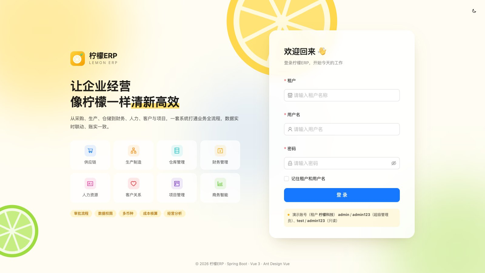
* 首页
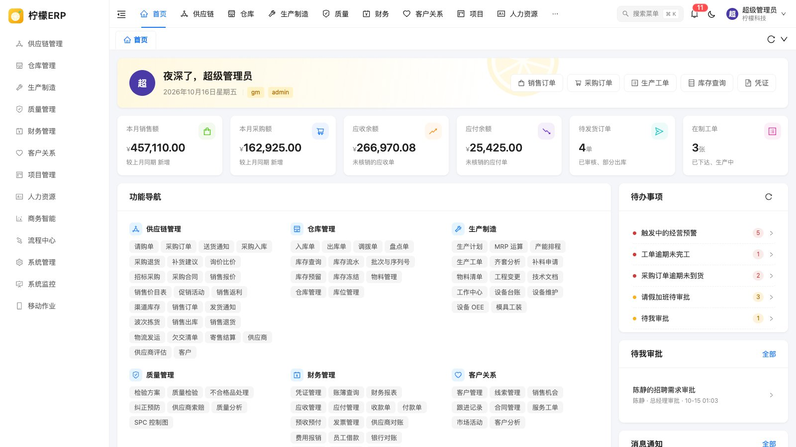
* 采购订单
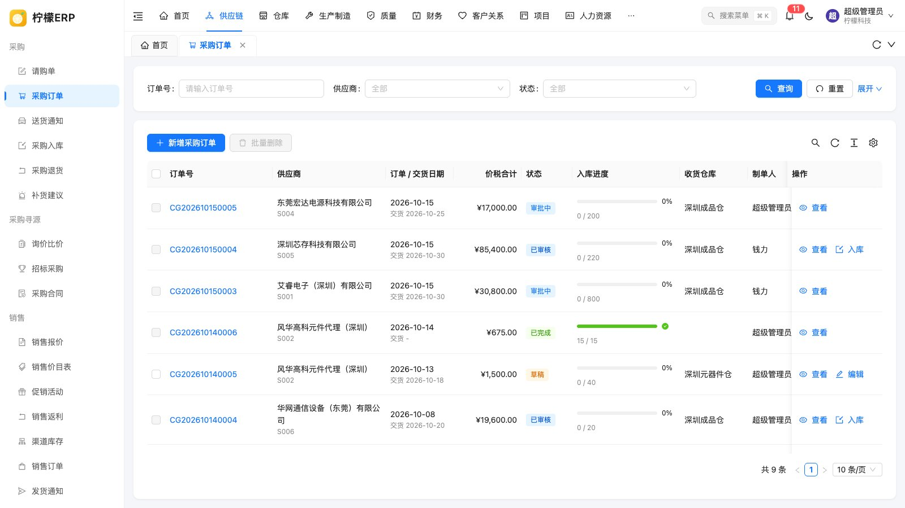
* 销售订单
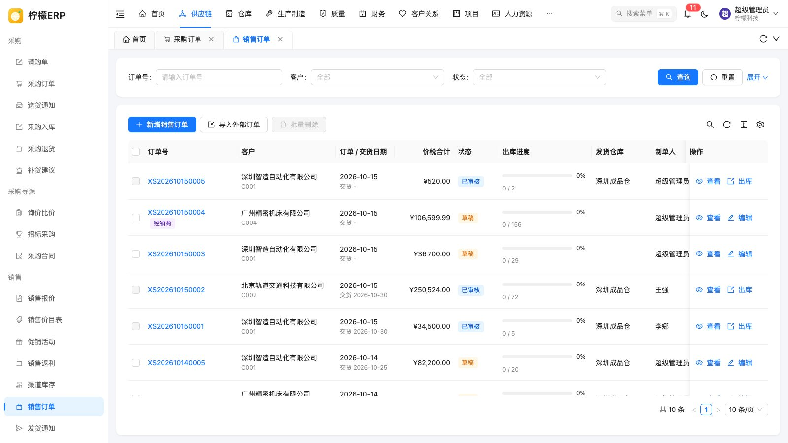
* 库存查询
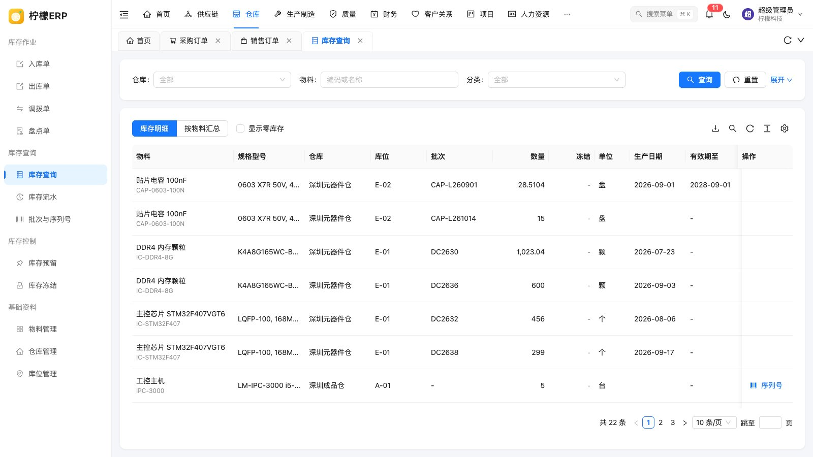
* 生产工单
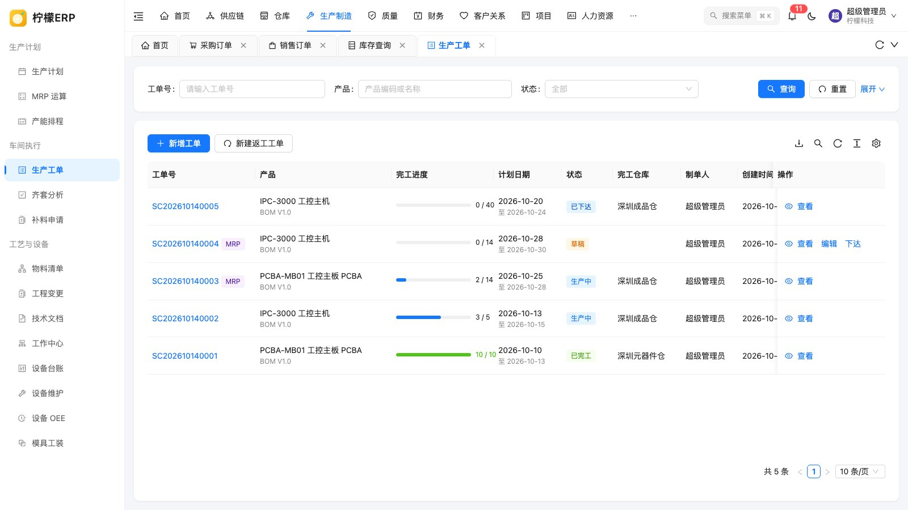
* MRP 运算
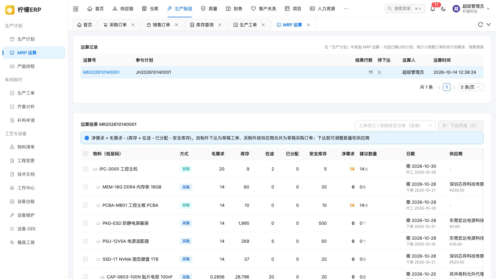
* 质量分析
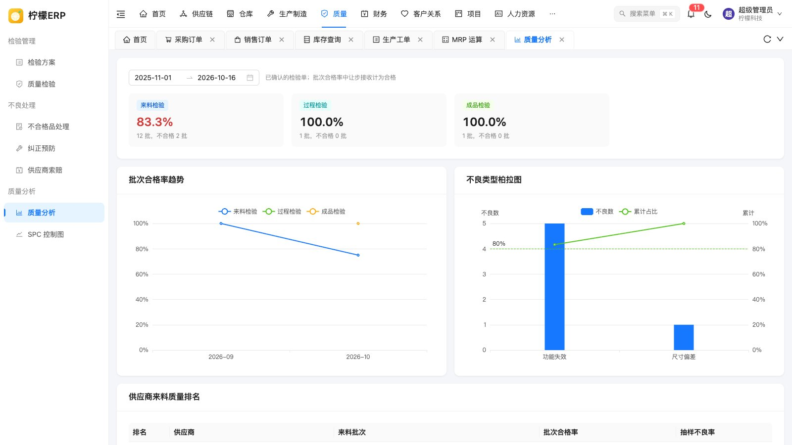
* 凭证管理
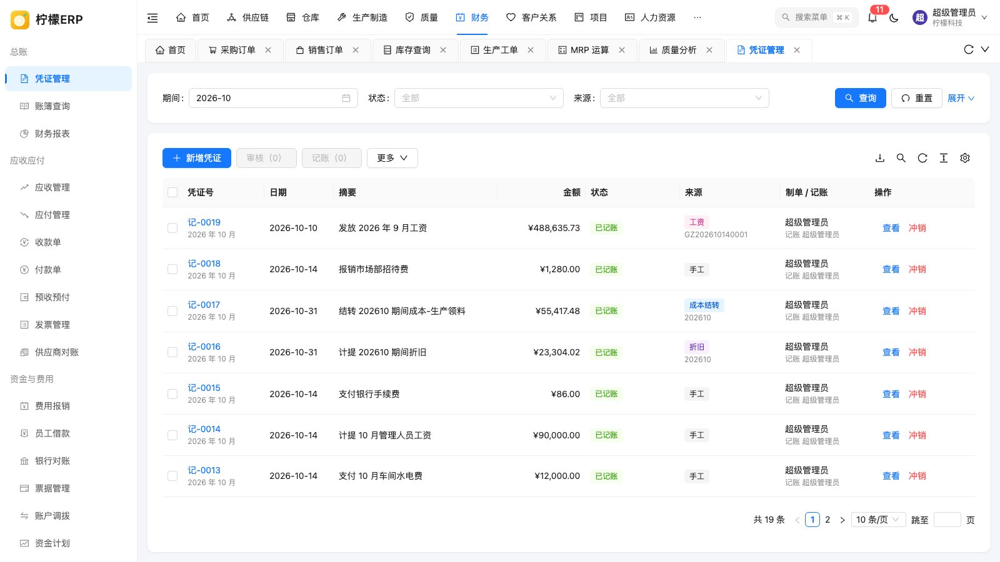
* 财务报表
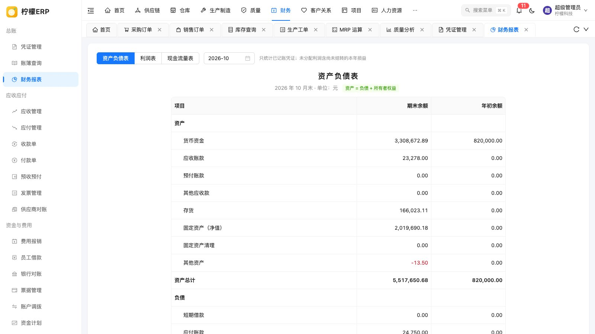
* 客户管理
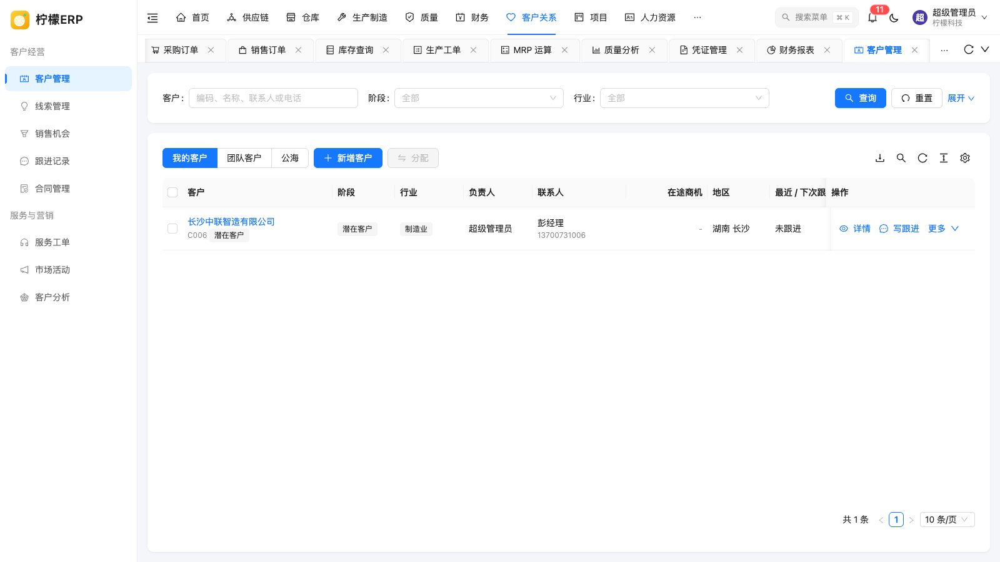
* 客户分析
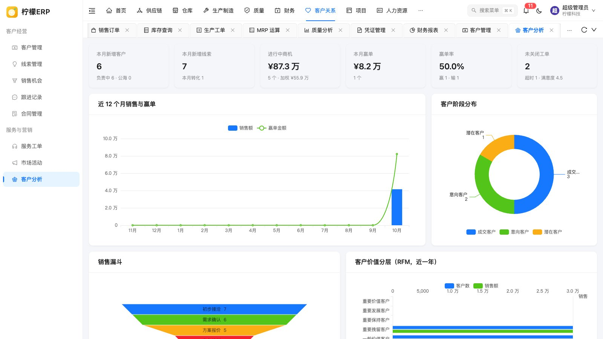
* 项目计划进度
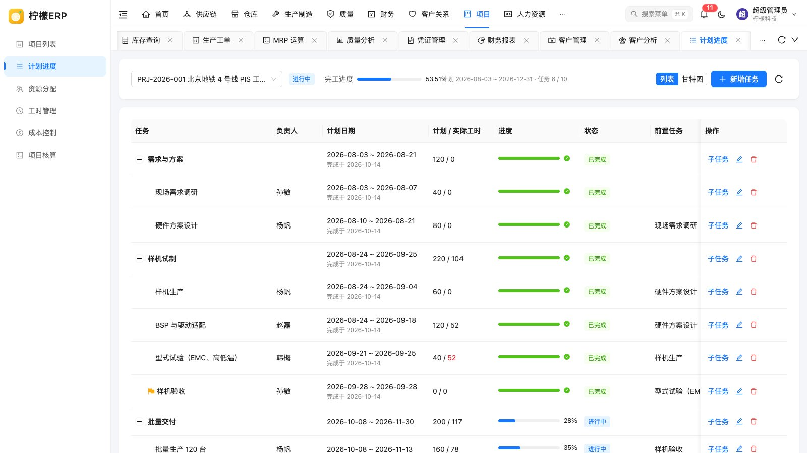
* 员工档案
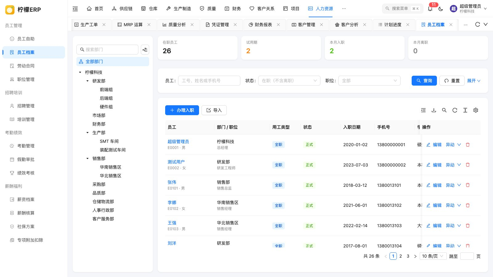
* 经营驾驶舱
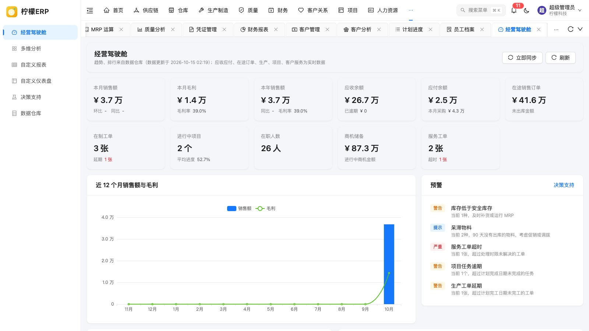
* 流程模型
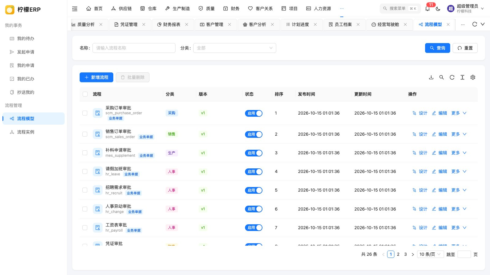
* 菜单管理
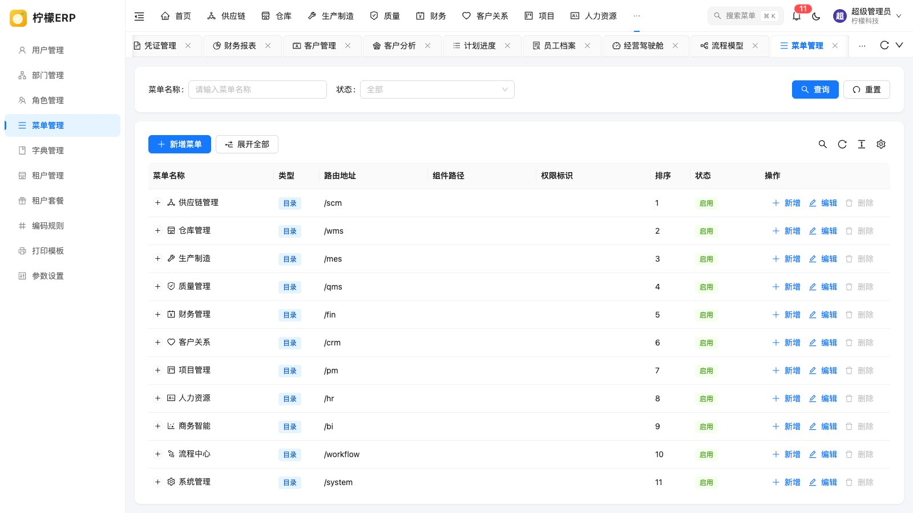
* 服务监控
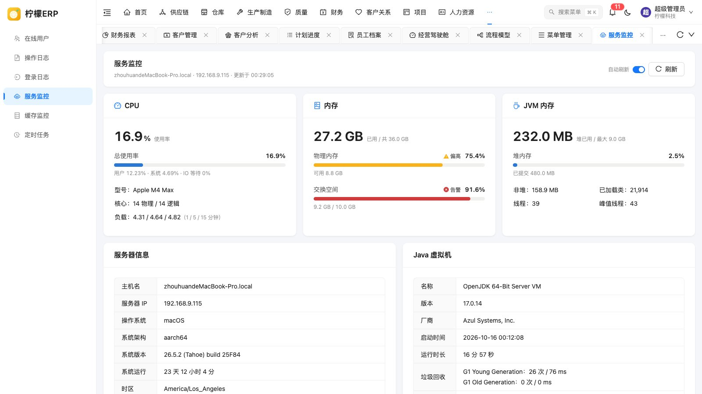

# 如何支持

* 开源不易，坚持更难！如果您觉得柠檬ERP 不错，请点一个 **Star** ⭐ 支持一下
* 把柠檬ERP 推荐给身边做生意、办工厂、做软件的朋友
* 遇到问题或有好的建议，欢迎在 [Issues](https://github.com/MakeSomeFakeNews/lemon-erp/issues) 中交流

# 许可证

[Apache License 2.0](LICENSE) © 2026 柠檬ERP
